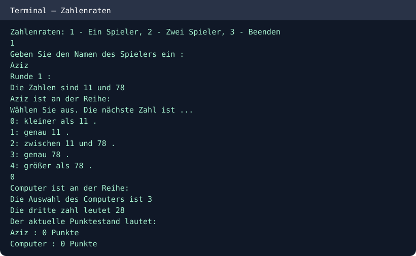

# Number Guessing Game — Zahlenraten (Java)

A console-based prediction game in Java. Guess where a random number lies relative to two known numbers. Play solo against a computer or with a second human player.

## Features
- One-player vs computer and two-player modes
- Five prediction choices
- Points for correct intervals and exact guesses
- Alternating turns and score tracking
- Input validation

## Run
```bash
javac -d out src/*.java
java -cp out ZahlenRaten
```

Choose 1 or 2 players, then enter a selection from 0–4. First player to 5 points wins the match.

## Console example


Java student programming project.